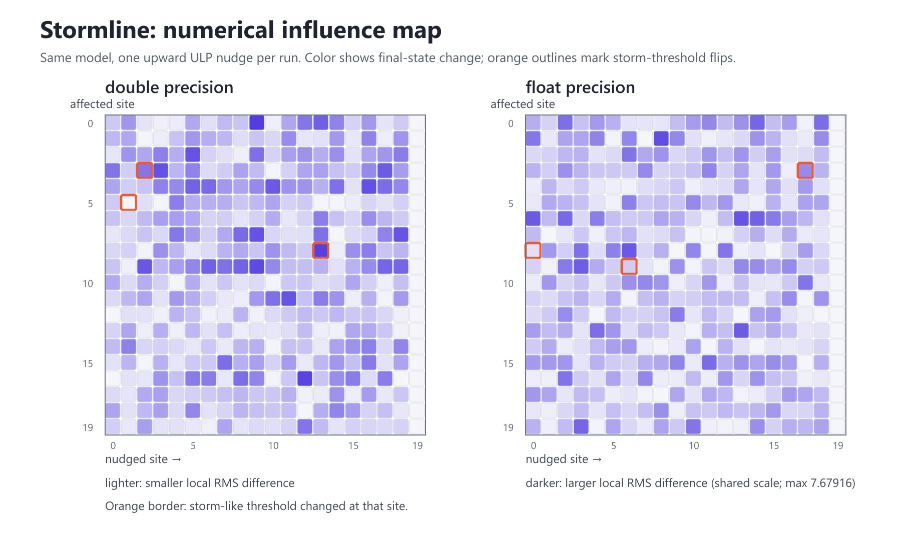

# Stormline Numerical Weather Lab

**A reproducible C++ experiment on numerical precision, chaotic weather models, and storm-threshold changes.**

Stormline asks a focused question: **when can a tiny change in a model's numbers alter its storm-like outcome?** It runs the same idealized case in single and double precision, nudges one starting value by one representable step at a time, and records how the differences spread.



Open the [vector version](stormline.svg) for a scalable copy of the same atlas.

## What it does

- Evolves a 20-site Lorenz-96 system with a fixed-step fourth-order Runge–Kutta method.
- Adds an explicitly experimental moisture, cloud, and rain layer to create a simple threshold event.
- Compares unperturbed `float` and `double` simulations.
- Runs one upward one-ULP initial-condition perturbation at every site in both precisions.
- Writes a CSV with the run settings, exact nudge size, rainfall totals, changed threshold sites, and final-state differences.
- Draws the sensitivity atlas above. Each column is the nudged site, each row is an affected site, cell shade shows the local state change, and orange outlines mark threshold flips.

The moisture and rain equations are a toy coupling for this numerical experiment. They are not a validated cloud-microphysics scheme. Stormline is not a weather forecast and its output should not be used as one.

## Build and run

You need a C++20 compiler and CMake 3.20 or newer.

```powershell
cmake -S . -B build
cmake --build build --config Release
```

Run the executable from the project folder:

```powershell
.\build\Release\stormline.exe --steps 6000 --dt 0.01 --output stormline.csv --svg stormline.svg
```

If your CMake generator puts the executable directly in `build`, use `.\build\stormline.exe` instead. Run `stormline.exe --help` to see the available options.

If `clang++` is available directly in your terminal, you can compile the source without CMake:

```powershell
clang++ -std=c++20 -Wall -Wextra -Wpedantic -O2 src/main.cpp -o stormline.exe
.\stormline.exe --steps 6000 --dt 0.01 --output stormline.csv --svg stormline.svg
```

## First recorded run

The committed [experiment report](EXPERIMENT_RESULTS.md) and [CSV output](stormline.csv) use 6,000 steps with a time step of 0.01. In that run, three of the 20 nudges in each precision changed at least one site's storm-threshold status. The report lists the nudged site and the affected site for each case.

The `float` one-ULP nudge near a value of 8 is about `9.54e-7`; the `double` nudge is about `1.78e-15`. The CSV records the exact amount for every run.

## Reading the output

The CSV has one row for the unperturbed precision comparison and one row per nudge. Useful fields:

- `ulp_delta`: the actual size of the starting nudge; `n/a` for the precision comparison.
- `changed_storm_site_ids`: `|`-separated site numbers where the rain-threshold classification changed.
- `rainfall_absolute_difference`: total absolute change in rain proxy across all sites.
- `final_state_rms_difference`: RMS difference in circulation, humidity, and cloud state at the end.

Large differences describe this model and this run configuration. They do not show that real storms depend on machine roundoff or that one precision is closer to observed weather.

## Project files

- `src/main.cpp` — model, integration, perturbation runs, CSV, and SVG output.
- `MODEL_NOTES.md` — equations, variables, and implementation choices in plain language.
- `EXPERIMENT_RESULTS.md` — interpretation of the recorded run and its limits.
- `stormline.csv` — full numeric output from the recorded run.
- `stormline.png` — the screenshot embedded above.
- `stormline.svg` — a scalable vector version of the atlas.
- `.github/workflows/build.yml` — Linux and Windows build checks.

## Scientific grounding

The circulation equation is the Lorenz-96 idealized atmospheric model, introduced by Edward Lorenz as a test model for predictability. Stormline's moisture and rain coupling is our experimental addition; it should not be confused with Lorenz's original model or a standard atmospheric parameterization. See [Lorenz, “Predictability: A Problem Partly Solved”](https://www.ecmwf.int/sites/default/files/elibrary/1995/10829-predictability-problem-partly-solved.pdf).

Stormline is a research project, not a claim of a new scientific method. A literature review and comparisons with established numerical-analysis methods are needed before making a novelty claim.
